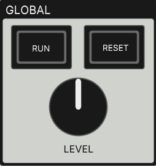

# GCD-8 for PureData

    

## Getting Started

### Requirements

GCD-8 depends on the [ELSE](https://github.com/porres/pd-else) and [cyclone](https://github.com/porres/pd-cyclone) libraries.

**Plugdata users:** nothing to install. Plugdata already includes both.

**Pure Data users:** install **ELSE v1.0-rc13** and **cyclone** via *Help → Find Externals*, then add both folders to *Preferences → Path*.

> [!WARNING]
> Use ELSE **v1.0-rc13**, not v1.0-rc14. GCD-8 was developed in Plugdata, which ships rc13 at the time of writing. rc14 introduced an undocumented breaking change to the `[button ]` object, which GCD-8 uses extensively. Stick with rc13 until a newer ELSE version is released.

### Quick start

Open `gcd8.quickstart.pd`. It has `[gcd8~]` already wired to the audio output, with comments explaining each outlet.

### Using GCD-8 in your own patches

Add the `abstractions/` folder to Pure Data's or Plugdata's search paths. You can then use the full instrument (`[gcd8~ ] `) in any patch, as well as its single-track sampler (`[gcd8.sampler~ ]`) and sequencer (`[gcd8.seq ]`) abstractions.

### Using GCD-8 in your DAW

Open `gcd8.daw.pd` in a Plugdata DAW plugin instance. Each track gets its own stereo output, and GCD-8 follows the DAW's tempo and transport.

> [!WARNING]
> Tested in Reaper only. Clock sync works reliably while the Plugdata window is closed or in the background, but interacting with it during playback or recording can make GCD-8 drift out of sync. Avoid interacting with the plugin window mid-take. This will be addressed in a future version.

## Reference

### 'Master Clock' Section

- do we add a brief description here?

| GUI Control | Description |
| ----- | ----------- |
| '**RATE**' knob     |             |
| '**Int./Ext.**' radio button     |             |

- Where do we mention that the second canvas displays the main clock id , which is useful to sync other `[else/clock ]`s to it? (with `[else/clock -s 1003-clk ]`)

### 'Global' Section

- do we add a brief description here?

| GUI Control | Description |
| ----- | ----------- |
| '**RUN**' button     |             |
| '**RESET**' button     |             |
| '**LEVEL**' knob     |             |

### Track Strips

- Here we want to say that each track strip consists of 2 GUI controls: the red button on top is the mute button and the button with number below is the selector. do we use a table ?

### Track Editor - Sampler

- Do we instead have a "### Track Editor" + a brief descrption saying that it consists of a sampler and a sequencer and then "#### Sampler Section" and a "#### Sequencer Section" ? 

| GUI Control | Description |
| ----- | ----------- |
| '**LOAD**' button     |             |
| '**TRIGGER**' button     |             |
| '**STOP**' button     |             |
| '**CLEAR**' button     |             |
| '**START POSITION**' slider     |             |
| '**END POSITION**' slider     |             |
| '**LEVEL**' knob     |             |
| '**AMP.**' knob     |             |
| '**TONE**' knob     |             |
| '**START**' knob     |             |
| '**ATTACK**' knob     |             |
| '**HOLD**' knob     |             |
| '**DECAY**' knob     |             |

### Track Editor - Sequencer

- How do we separate base pattern from dyanmics and panning?

| GUI Control | Description |
| ----- | ----------- |
| '**STEP RATE**' radio button     |             |
| '**LENGTH**' knob     |             |
| '**HITS**' knob     |             |
| '**SHIFT**' knob     |             |

| GUI Control | Description |
| ----- | ----------- |
| (Jitter) '**DEPTH**' knob     |             |
| (Jitter) '**CEILING**' knob     |             |
| (Accents) '**QUANTITY**' knob     |             |
| (Accents) '**INTENSITY**' knob     |             |
| (Accents) '**SHIFT**' knob     |             |

| GUI Control | Description |
| ----- | ----------- |
| '**HITS**' knob     |             |
| '**SPREAD**' knob     |             |
| '**SIDE**' radio button    |             |

### Inlets
| Inlet | Description |
| ----- | ----------- |
| 0     |             |
| 1     |             |

### Outlets
| Outlet | Description |
| ------ | ----------- |
| 0-1    | Main mix L/R outputs            |
| 2-17   | Individual track L/R output pairs            |
| 18-21  | Track #7 euclidean sequencer direct outputs (18)            |
| 22-25  | Tracl #8 euclidean sequencer direct outputs (22=...)            |

## License

This project is licensed under the GNU General Public License v3.0. See [LICENSE](LICENSE) for details.