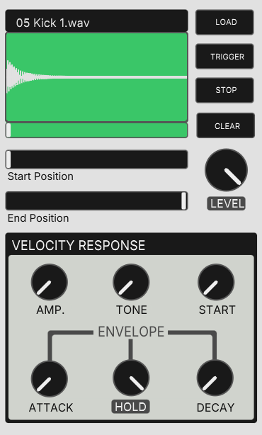
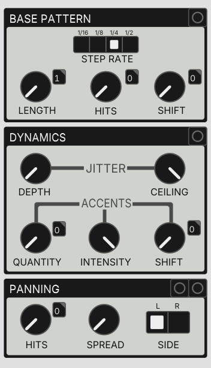

# GCD-8 for PureData

    

## Getting Started

### Requirements

GCD-8 depends on the [ELSE](https://github.com/porres/pd-else) and [cyclone](https://github.com/porres/pd-cyclone) libraries.

**Plugdata users:** nothing to install. Plugdata already includes both.

**Pure Data users:** install **ELSE v1.0-rc13** and **cyclone** via *Help → Find Externals*, then add both folders to *Preferences → Path*.

> [!WARNING]
> Use ELSE **v1.0-rc13**, not v1.0-rc14. GCD-8 was developed in Plugdata, which ships rc13 at the time of writing. rc14 introduced an undocumented breaking change to the `[button ]` object, which GCD-8 uses extensively. Stick with rc13 until a newer ELSE version is released.

### Quick start

Open `gcd8.quickstart.pd`. It has `[gcd8~]` already wired to the audio output, with comments explaining each outlet.

### Using GCD-8 in your own patches

Add the `abstractions/` folder to Pure Data's or Plugdata's search paths. You can then use the full instrument (`[gcd8~ ] `) in any patch, as well as its single-track sampler (`[gcd8.sampler~ ]`) and sequencer (`[gcd8.seq ]`) abstractions.

### Using GCD-8 in your DAW

Open `gcd8.daw.pd` in a Plugdata DAW plugin instance. Each track gets its own stereo output, and GCD-8 follows the DAW's tempo and transport.

> [!WARNING]
> Tested in Reaper only. Clock sync works reliably while the Plugdata window is closed or in the background, but interacting with it during playback or recording can make GCD-8 drift out of sync. Avoid interacting with the plugin window mid-take. This will be addressed in a future version.

## Usage Guide

### Global Controls

- Brief intro to this README section?

MASTER CLOCK section:
- **RATE** knob controls the clock speed in BPM. The value is displayed above it.
- **INT. / Ext.** radio button sets the clock mode. On external mode, the **RATE** knob is ignored and the rate is set via the second inlet. 
- Next to the rate BPM display, the ID of the clock is displayed. Our master clock , internally, uses `[else/clock ]` , which can be set to be the slave of another `[else/clock ]` if we know its ID. This means that you can easily sync other clocks to the instrument's master clock by using its id, for example: `[else/clock -s 1003-clk ]` 

TRANSPORT: 
- **RUN** button to start advancing the sequencers
- **RESET** button to reset all track's sequencers back to step 0

- The **LEVEL** knob under the **MAIN OUTPUT** section controls the main mix output level.

### Selecting Tracks for Editing

- here we jsut want to say that in order to edit a specific track, we select it by pressing the track number button at the bottom of the track strip. 
- the currently selected track is highlighted (background and border change their colors) 

### Loading Samples

Briefly talk about the buttons:
- **LOAD** button to open the file explorer and load an audio file
- **TRIGGER** button to play the sample (this plays at full velocity)
- **STOP** button to stop playback (useful for longer samples, we would have to wait until they reach the end)
- **CLEAR** to clear the loaded sample

Briefly say that the **START POSITION** and **END POSITION** sliders are used to trim the active region of the loaded sample

The **LEVEL** knob acts as a gain(?) trimmer. At max, gain = 1. 

### Programming the Base Pattern

Here we say that this section controls the track's main euclidean sequencer. The **LENGTH**, **HITS** and **SHIFT** knobs are the usual euclidean parameters (do we explain ?). The **STEP RATE** radio button selects between 4 step resolutions (resolutions? rates?): 1/16, bl abl a

### Adding Dynamics to the Sequence

- Brief intro to this section (this is responsible for making our rhythmic pattern more expressive. With the default settings, this is essentially bypassed, so all hits are played with max velocity by defaut. )

- The jitter controls makes each hit be played at a random velcoity with its maximum value determined by the **CEILING** knob. The greater the **DEPTH** knob, the greater the range of velocity values while jittering. 

- The accent controls determine which hits from the base pattern are accented. Internally, this uses another euclidean sequencer that is slaved(?) to the main one: 
    - Instead of advancing on every step, it only advances whenever there is a HIT on the base pattern
    - The length of the euclidean sequence is always the same as the number of base pattern HITS. 
    - So , while the BASE PATTERN sequencer answers the question "From this sequence of X steps where Y are hits, which ones are hits?", this sequencer answers the question "From these hits, which ones should be accented?"
- The **QUANTITY** knob determines hor many HITS (from the base pattern) are accented. The **INTENSITY** knob determines how much too boost the velocity when a hit is accented. 
- The SHIFT knob shifts the accent sequence by 1 step. 
- Maybe we should say that the JITTER and ACCENTS sub-sections work closely together. For example: with a high INTENSITY and a low jitter CEILING, the accents are very pronounced. If jittering DEPTH is set to 0 (so no jittering), this essentially means that there are no accents aswell (because our accents essentially BOOST the generated velocities while ittering - confim this please)
- We should also note that in order for the accents to (???), we should decrease value of jitter CEILING (research this so you understan dwhat im talking about)

### Tuning the Sampler's Velocity Response
- The VELCOITY RESPONSE section under the sampler allows for finetuning of how different velocities affect different sonic characteristics of the sample(?). 
- All knobs under this section **except the envelope HOLD knob** are "depths". This means that on minimum position, depth = 0, so there is no velocity response for that parameter/characteristic(?). As we increase these knobs, the greater impact is felt in thei respective what(?) for different(?) velocities 
- The **AMP.** knob determines how velocity affects the amplitude level of the audio playback. If set to maximum -> exponential? Velocity is decreased by V² ? (is this true?)
- The **TONE** determines the minimum low-pass filter cutoff frequency. The greater this value, the duller lower velocities sound in relation tohigher velocities. 
- The **START** knob determines how much to skip bl abl a
- The **ATTACK** knob...
- The **DECAY** knob..
- The **HOLD** knob : this is a special case . It is not directly affected by velocity. It determines the length of the HOLD section of the AHD amplitude envelope. At minimum position: AD envelope. Maximum position: AHD envelope where the HOLD stage can take up to x%?? (confirm this) 

A few note sthat we somehow maybe should include: 
- The way we finetune the vleocity repsonse depends entirely on the loaded sample's characteristics. Some samples benefit from certain controls , while others bl abla. 
- Maybe examples like: for very short and dry samples (e.g., a wooden stick hit?), **AMP.** and maybe a bit of **TONE** is usually enough. For samples with a longer ringing tail (??), the START knob in conjunction with the TONE and DECAY are very useful, particularly if the sample has a very strong transient (on lower velocities, it would sound very weird if we left the transient intact, so we can lverage the **START** knob to skip some parts of.. and maybe apply a bit of **ATTACK** to smoothen out the transient on lower velocities)
- Maybe we can also note that tweaking the HOLD knob while adjusting the START and END sliders above the VELCOITY RESPONSE section can used isolate a certain part of a longer audio samples (not one shot) and make it percussive

### Panning

- Like the Accents, this is another euclidean sequencer internally that is slaved to the base pattern one (length = base pattern hits, only advances on every hit), but the question is answers is: "From these hits, which ones should be played on my preferred side?" Preferred??
- The **HITS** knob determines how many hits are from the base pattern are tilted/biased/??? or "should be panned"? to the side selected using the **SIDE** radio button. 
- The **SPREAD** knob determines the how much (...) If set to min. (default) <-- this yield no effect. As we increase this knob's alue, the "lefter L sounds and righter the R sounds". At full position, a hit is either played full L or full R. <--- also mention equal power panning!!! 

### Muting Tracks
- The red buttons on top of each track strip allows us mute tracks. If the track is unmuted, the button is red, otherwis eit is greyed out (and its HIT BANG(??) aswell ). 
- The first inlet of this instrument accepts the `toggle` method (e.g., `[mute 2 (` to mute track 2), which can be used to, for example, patch a MIDI controller input in order to make it mute/unmute each of the 8 tracks manually (with physicial controllers). This makes the instrument very playable.  

### Inlets
| Inlet | Description |
| ----- | ----------- |
| 0     |             |
| 1     |             |

### Outlets
| Outlet | Description |
| ------ | ----------- |
| 0-1    | Main mix L/R outputs            |
| 2-17   | Individual track L/R output pairs            |
| 18-21  | Track #7 euclidean sequencer direct outputs (18)            |
| 22-25  | Tracl #8 euclidean sequencer direct outputs (22=...)            |

## License

This project is licensed under the GNU General Public License v3.0. See [LICENSE](LICENSE) for details.