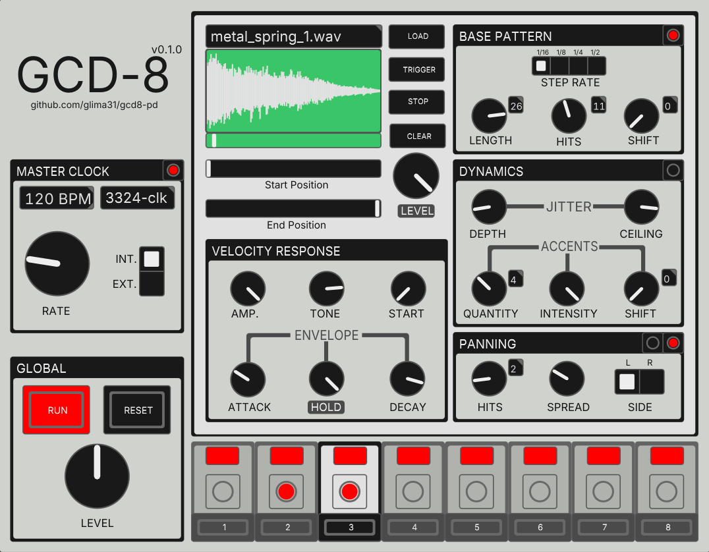
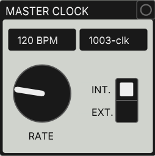
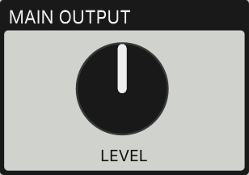
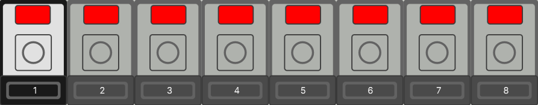
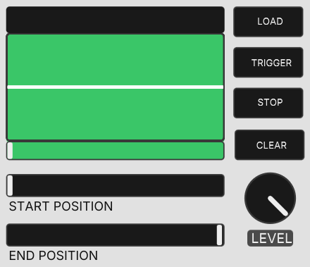
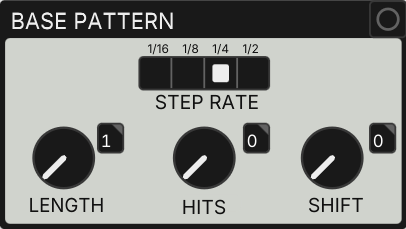
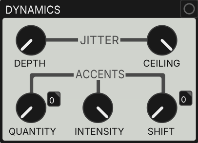
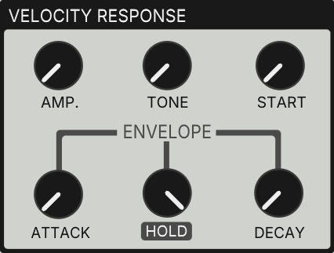
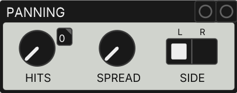
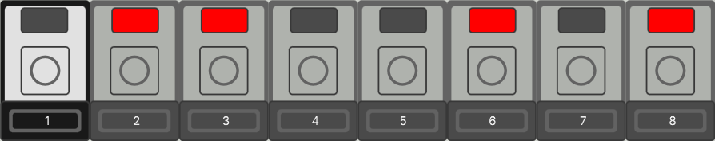

# GCD-8 for PureData

<p align="center">
    
</p>

GCD-8 is an 8-track expressive rhythm programmer. Each track pairs a sample player with a euclidean sequencer, while dynamics and panning controls vary each hit's velocity and give the patterns an interesting stereo image. At the heart of the instrument is the sampler's velocity response section, which lets you shape how different velocities affect the sound.

The idea behind this instrument came out of necessity. As a musician with a strong interest in industrial music and in compositional approaches inspired by musique concrète, after spending (too much) time collecting and cataloguing a vast number of percussive samples, i found myself in need of  a way to sequence them without everything sounding too machine-like. Some initial experiments in VCV Rack validated my own velocity response implementation, so I decided to encapsulate it all in Pure Data.

Once I was happy with my Pd sampler and its velocity response, the obvious next step was to add rhythmic pattern generation. That's how GCD-8 was born.

GCD-8's main features are its custom velocity response and the sequencer's dynamics controls, but that doesn't mean expressive patterns are all it's for. With little to no tweaking on the dynamics controls, It can also generate intricate robotic rhythms for those who enjoy a more "old-school" machine-like aesthetic, as you can hear in my [GCD-8 - Electrowerk 808 demo video]().

## Table of Contents
- [Demos](#demos)
- [Features](#features)
- [Getting Started](#getting-started)
    - [Requirements](#requirements)
    - [Quick Start](#quick-start)
    - [Using GCD-8 in your own patches](#using-gcd-8-in-your-own-patches)
    - [Using GCD-8 in your DAW](#using-gcd-8-in-your-daw)
- [Usage Guide](#usage-guide)
    - [Configuring the Master Clock](#configuring-the-master-clock)
    - [Controlling the Sequencer State](#controlling-the-sequencer-state)
    - [Adjusting the Main Mix Output Level](#adjusting-the-main-mix-output-level)
    - [Selecting Tracks for Editing](#selecting-tracks-for-editing)
    - [Loading and Auditioning Samples](#loading-and-auditioning-samples)
    - [Programming the Base Pattern](#programming-the-base-pattern)
    - [Adding Expressiveness](#adding-expressiveness)
        - [Jitter and Accents](#jitter-and-accents)
        - [Tuning the Sampler's Velocity Response](#tuning-the-samplers-velocity-response)
    - [Panning](#panning)
    - [Muting Tracks](#muting-tracks)
    - [Inlets](#inlets)
    - [Outlets](#outlets)
- [License](#license)

## Demos
### Video 1
Link
Description

### Video 2
Link 
Description

### Video 3
Link
Description

## Features
- Custom **velocity response** implementation with controls to shape how velocity affects **amplitude**, **tone**, **start position**, **attack** and **decay**
- AHD amplitude envelope with velocity-sensitive attack and decay stages and user-defined HOLD stage length (with the possibility of turning the AHD envelope into AD)
- **Euclidean rhythm generator** with controls for **step rate**, **length**, **hits** and **shift/rotation**
- **Random velocity generator** (jitter) with controls for **depth** and **ceiling**
- **Euclidean accent generator** with controls for accent **quantity**, **intensity** and **shift**
- **Euclidean panner** with controls for **hits**, **spread** and **side** (L/R)  
- Start and End position trimmers to crop the loaded samples active regions
- Invididual track level control
- `run` and `reset` methods for external transport actions
- Mute tracks externally with the `mute $TRACK_NR` method
- Ability to set the clock's BPM externally 
- Main mix stereo outlets
- Indvidual outlets for each track stereo output pairs
- Track #7 and #8 euclidean sequencer direct outlets
- Full state persistence (arrays, knobs, etc.)


## Getting Started

### Requirements

GCD-8 depends on the [ELSE](https://github.com/porres/pd-else) and [cyclone](https://github.com/porres/pd-cyclone) libraries.

**Plugdata users:** nothing to install. Plugdata already includes both.

**Pure Data users:** install **ELSE v1.0-rc13** and **cyclone** via *Help → Find Externals*, then add both folders to *Preferences → Path*.

> [!WARNING]
> Use ELSE **v1.0-rc13**, not v1.0-rc14. GCD-8 was developed in Plugdata, which ships rc13 at the time of writing. rc14 introduced an undocumented breaking change to the `[button ]` object, which GCD-8 uses extensively. Stick with rc13 until a newer ELSE version is released.

### Quick start

Open `gcd8.quickstart.pd`. It has `[gcd8~]` already wired to the audio output, with comments explaining each outlet.

### Using GCD-8 in your own patches

Add the `abstractions/` folder to Pure Data's or Plugdata's search paths. You can then use the full instrument (`[gcd8~ ] `) in any patch, as well as its single-track sampler (`[gcd8.sampler~ ]`) and sequencer (`[gcd8.seq ]`) abstractions.

### Using GCD-8 in your DAW

Open `gcd8.daw.pd` in a Plugdata DAW plugin instance. Each track gets its own stereo output, and GCD-8 follows the DAW's tempo and transport.

> [!WARNING]
> Tested in Reaper only. Clock sync works reliably while the Plugdata window is closed or in the background, but interacting with it during playback or recording can make GCD-8 drift out of sync. Avoid interacting with the plugin window mid-take. This will be addressed in a future version.

## Usage Guide

### Configuring the Master Clock



The **RATE** knob controls the clock speed in BPM when the clock is set to internal mode (**INT.**).

If the clock is set to external mode (**EXT.**), the clock rate is set by the second inlet of the abstraction, so the **RATE** knob is effectively ignored.

>[!TIP]
>The master clock implementation is based on `[else/clock ]`, which makes it very easy to create slave clocks that are guaranteed to be synced to the master. For this reason, on the right side of the BPM display, the clock ID is shown. This makes it possible to create other clocks in the same patch as gcd-8 that are synced to GCD-8's master clock by instanting them with the `-s` flag followed by the clock ID: 
>```
>[else/clock -s 1003-clk]
>```


### Controlling the Sequencer State


To start advancing the internal euclidean sequencers, press the **RUN** button. The button background color wlil turn to red while the sequencers are running. 

To stop the sequencers, press the **RUN** button again. 

>[!NOTE]
>It is also possible to start/stop the sequencer using the first inlet: `1` to start, `0` to stop 

The **RESET** button resets all internal sequencers back to step 0. This is particularly useful for multi-track recording in separate takes inside a DAW while guaranteeing that the new take starts 

>[!NOTE]
>**The internal sequencers do not automatically reset back to step 0** when the sequencer is started or stopped. The **RESET** button is particularly useful when you want to guarantee that all the sequences start from the beginning (for example, when layering tracks in separate recording takes inside a DAW), 


### Adjusting the Main Mix Output Level


The **LEVEL** knob acts as a level trimmer for the main mix output (coming out of inlets 0 and 1). Thishis doesn't impact the levels coming out of the individual track outlets.


### Selecting Tracks for Editing


By default, the track editor displays the sampler and sequencer controls for track #1. To edit another track, **click on its respective numbered button**. 

The currently selected track's strip has its border and background conveniently highlighted. 


### Loading and Auditioning Samples


On the right side of the sampler's waveform display (the green graph), there are 4 buttons:
- **LOAD**: load an audio file into the currently selected track's sampler. 
- **TRIGGER**: play the sample at full velocity
- **STOP**: stop playback (useful for longer samples)
- **CLEAR**: clear the loaded sample

The **START POSITION** and **END POSITION** sliders lets you trim the sample's active region. 

The **LEVEL** knob acts as a level trimmer for the selected track. By default, it is set to max. (unity). 


### Programming the Base Pattern


The **BASE PATTERN** section exposes the controls that are typically found on any euclidean pattern generator:
    - **LENGTH**: the total number of steps in the sequence (from 1 to 32)
    - **HITS**: how many hits in the sequence. When this knob is set to the maximum position, all the steps are hits. 
    - **SHIFT**: as this knob is turned clockwise, the whole pattern is shifted by 1 step.

The **STEP RATE** radio button allows you to change the selected track's intenrnal clock speed in relation to the **MASTER CLOCK**. By default, this is set to `1/4` (1 step per quarter note), but you can make it faster up to `1/16` (1 step per sixteenth note) or slow it down to `1/2` (1 step per half note). 


### Adding Expressiveness

By default, every hit is played at full velocity. To make a pattern more expressive, use the **DYNAMICS** section to [play hits at different velocities](#jitter-and-accents), and the **VELOCITY RESPONSE** section to [tune how the sample responds to them](#tuning-the-samplers-velocity-response).

#### Jitter and Accents


The **DYNAMICS** section generates a velocity for every hit of the base pattern. It has two parts, **JITTER** and **ACCENTS**. With the default settings, neither has any effect and every hit is played at full velocity.

**JITTER** plays each hit at a random velocity:
- **CEILING**: the maximum velocity.
- **DEPTH**: how far below the **CEILING** the random velocities can go. At `0` (default), every hit is played exactly at the **CEILING**. At its maximum position, velocities can be anywhere between `0` and the **CEILING**.

**ACCENTS** boost the velocity of selected hits. To select them, each track has a second euclidean sequencer that only advances on base pattern hits, and whose length is always equal to the number of base pattern **HITS**. While the base pattern answers the question "which of these steps are hits?", the accent sequencer answers "which of these hits are accented?".
- **QUANTITY**: how many of the base pattern hits are accented.
- **INTENSITY**: how much an accented hit's velocity is boosted.
- **SHIFT**: as this knob is turned clockwise, the accent pattern is shifted by 1 hit.

>[!NOTE]
>Accents use the headroom above the **CEILING**: an accented hit gets `INTENSITY × (1 - CEILING)` added to its velocity. This means that **with the CEILING at its maximum position (default), accents have no effect**. Lower the **CEILING** to make room for them.

To exemplify, let's say we set the **CEILING** to `0.5`, the **DEPTH** to `0` and the **INTENSITY** to its maximum position. Non-accented hits are played at `0.5` and accented hits at full velocity (`1.0`). Increasing the **DEPTH** then randomizes both, while accented hits always stay above the non-accented ones.


#### Tuning the Sampler's Velocity Response


The **VELOCITY RESPONSE** section determines how a hit's velocity shapes the sound of the sample.

All knobs except **HOLD** are depths: at their minimum position (default), velocity has no effect on their parameter. The higher the depth, the more softer hits differ from hits at full velocity, which are never affected by these knobs.

- **AMP.**: lowers the level of softer hits. At its maximum position, the level follows the velocity squared (a hit at velocity `0.5` plays at a quarter of the level).
- **TONE**: makes softer hits darker, using a low-pass filter. At its maximum position, the cutoff goes from 24 kHz at full velocity down to 600 Hz at velocity `0`.
- **START**: makes softer hits skip the beginning of the sample. At its maximum position, a hit at velocity `0` starts halfway through the sample's active region.
- **ATTACK**: makes softer hits fade in more slowly, with up to 150 ms of attack at velocity `0`.
- **DECAY**: makes softer hits shorter. At its maximum position, a hit at velocity `0` lasts 15% of its normal length.
- **HOLD**: not affected by velocity. It sets the length of the hold stage of the AHD amplitude envelope, from `0` (an AD envelope that decays right after the attack) up to 95% of the envelope (default). The rest is the decay stage.

>[!TIP]
>The right settings depend entirely on the sample. For short, dry samples (e.g., a wooden stick hit), **AMP.** and a bit of **TONE** are usually enough. For samples with a strong transient and a longer tail, combine **START** with **TONE** and **DECAY**: on soft hits, an untouched transient sounds unnatural, so use **START** to skip part of it and a bit of **ATTACK** to smooth out what's left.

>[!TIP]
>Lowering the **HOLD** while adjusting the **START POSITION** and **END POSITION** sliders lets you isolate part of a longer sample (not a one-shot) and turn it into a percussive sound.


### Panning


Just like the **accent generator**, each track has another "slave" euclidean sequencer that only advances when there is a base pattern hit and its length (the total number of steps) is always equal to the number of **HITS** set in the **BASE PATTERN** section. 

The **HITS** knob of the **PANNING** section determines how many hits in the base sequence should be panned to our preferred side. 

The preferred side is set with the **SIDE** radio button. 

The **SPREAD** knob sets the (???) between each sides of the stereo field. By default, it is set to 0 , meaning that the hits will always be centered regardless of hte value of the **HITS** knob. The higher the value of the **SPREAD** knob, the (???) ... mention equal power panning??. With this knob set to ts maximum position, our hits play either fully `L` or fully `R` (depending on the values of the other controls). 

To exemplify, let's say we have a base pattern of `16` steps from which `4` are hits. If we set our **SIDE** to `R`, increase hte **SPREAD** a bit and set the **HITS** to `2`, the panning will alternate on every hit (the first hit will be panned to the right, the second one to the left, the third one to the rigth, etc...).  

>[!NOTE]
>If the **HITS** knob is set to its maximum position, **all hits in the sequence** will be panned to **SIDE**. 


### Muting/Unmuting Tracks


The button on top of each track strip acts as a mute/unmute toggler. When a track is **muted**, the button is grey. Otherwise, it is red.

It is also possible to toggle the mute/unmute status of a specific track with the **1st inlet's** `mute` **method** (e.g., `[mute 2 (` to mute/unmute track 2).

>[!Tip]
>If you have a hardware MIDI controller/keyboard, you can easily assign certain buttons/keys to mute/unmute specific tracks. This makes GCD-8 very "jammable". 

>[!NOTE]
>All the signal outlets (main mix + individiual tracks) are **post-mute**.


### Inlets
| Inlet | Accepted Values / Methods |
| ----- | ----------- |
| 0     | float: `0` to start the sequencer, `1` to stop it   |
|       | `ext`: set the master clock to external (**EXT.**) mode  |
|       | `mute <f>`: mute/unmute a specific track (e.g., `[mute 2 (` to mute/unmute track 2) |
| 1     | float: clock rate (BPM). This is ignored if the clock is set to internal (**INT.**) mode  |


### Outlets
| Outlet | Description |
| ------ | ----------- |
| 0-1    | Main mix L/R outputs (post-fader, post-mutes)           |
| 2-17   | Individual track L/R output pairs (post-fader, post-mute)            |
| 18-21  | Track #7 sequencer direct outs (hit(bang), velocity(0.0-1.0), accent(bang), rest(bang))            |
| 22-25  | Track #8 sequencer direct outs (hit(bang), velocity(0.0-1.0), accent(bang), rest(bang))            |

## License

This project is licensed under the GNU General Public License v3.0. See [LICENSE](LICENSE) for details.